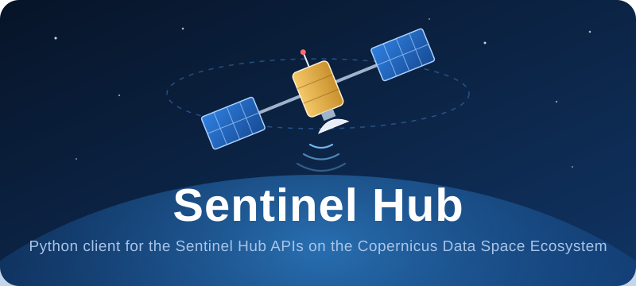

<p align="center">
  
</p>

<p align="center">
  
  
  
  
  <a href="LICENSE"></a>
</p>

## Table of Contents

- [Introduction](#introduction)
- [Installation](#installation)
- [Quick start](#quick-start)
- [Services](#services)
- [Development](#development)
- [Changelog](CHANGELOG.md)
- [License](#license)

## Introduction

**`sentinel-hub`** is a lightweight Python client for the
[Sentinel Hub](https://documentation.dataspace.copernicus.eu/APIs/SentinelHub.html) APIs
hosted on the [Copernicus Data Space Ecosystem (CDSE)](https://dataspace.copernicus.eu/).
It lets you search the satellite archive, download processed imagery straight into
NumPy arrays and compute statistics over time, without hand-crafting HTTP requests.

Highlights:

- **Catalog API** – STAC search over Sentinel-2 L1C / L2A by time, area, IDs and CQL2 filters, with lazy pagination.
- **Process API** – request processed imagery (TIFF, PNG, JPEG, JSON, multi-output TAR) for any bbox or polygon.
- **Statistical API** – get statistics, percentiles and histograms per time interval without downloading images.
- **Evalscript generator** – build a valid `//VERSION=3` evalscript from a list of band names.
- **Geometry toolkit** – `BBox`, `Geometry` and `CRS` with reprojection, buffering, partitioning and UTM helpers.
- **Command line interface** – `sentinel-hub search | process | stats | evalscript | config ...` for the common tasks without writing Python.
- **Robust downloads** – OAuth2 session handling and caching, automatic retries with back-off, rate-limit handling, multi-threading and on-disk response caching.

## Installation

Requires **Python 3.14+**. The package is not on PyPI yet, so install it from GitHub:

```bash
# with uv
uv add git+https://github.com/janpeix04/sentinel-hub.git@v0.2.0

# or with pip
pip install git+https://github.com/janpeix04/sentinel-hub.git@v0.2.0
```

Then [set up your CDSE credentials](docs/configuration.md).

## Quick start

```python
from sentinel_hub import (
    CRS, BBox, DataCollection, LastIntervalBehavior, MimeType, SHCatalog, SHConfig,
    SHRequest, SHStatistical, bbox_to_dimensions, generate_evalscript,
)

config = SHConfig()  # reads config.toml / SH_CLIENT_ID / SH_CLIENT_SECRET
bbox = BBox((13.35, 45.85, 13.55, 46.0), crs=CRS.WGS84)
time_interval = ("2024-06-01", "2024-06-30")

# 1. Find scenes
catalog = SHCatalog(config=config)
results = catalog.search(
    DataCollection.SENTINEL2_L2A.catalog_id,
    bbox=bbox,
    time=time_interval,
    filter="eo:cloud_cover < 20",
)
print(results.get_timestamps())

# 2. Download a true-colour image
request = SHRequest(
    evalscript=generate_evalscript(
        DataCollection.SENTINEL2_L2A, bands=["B04", "B03", "B02"], merged_bands_output="default"
    ),
    input_data=[
        SHRequest.input_data(DataCollection.SENTINEL2_L2A, time_interval=time_interval, maxcc=0.2)
    ],
    responses=[SHRequest.output_response("default", MimeType.TIFF)],
    bbox=bbox,
    size=bbox_to_dimensions(bbox, resolution=10),
    config=config,
)
image = request.get_data()[0]  # numpy array, shape (height, width, 3)

# 3. Mean NDVI per 10 days, without downloading images
ndvi_evalscript = """
//VERSION=3
function setup() {
  return {
    input: [{ bands: ["B04", "B08", "dataMask"] }],
    output: [{ id: "ndvi", bands: 1, sampleType: "FLOAT32" }, { id: "dataMask", bands: 1 }]
  };
}
function evaluatePixel(s) {
  return { ndvi: [(s.B08 - s.B04) / (s.B08 + s.B04)], dataMask: [s.dataMask] };
}
"""
stats_request = SHStatistical(
    aggregation=SHStatistical.aggregation(
        evalscript=ndvi_evalscript,
        time_interval=time_interval,
        aggregation_interval="P10D",
        last_interval_behavior=LastIntervalBehavior.SHORTEN,  # keep the partial last interval
        size=bbox_to_dimensions(bbox, resolution=10),
    ),
    input_data=[SHStatistical.input_data(DataCollection.SENTINEL2_L2A, maxcc=0.2)],
    bbox=bbox,
    config=config,
)
for interval in stats_request.get_data()[0]["data"]:
    print(interval["interval"]["from"], interval["outputs"]["ndvi"]["bands"]["B0"]["stats"]["mean"])
```

## Services

Each topic has its own page in [`docs/`](docs). Pick the one you need:

| Service | What it covers | Main objects | Docs |
|---|---|---|---|
| ⚙️ **Configuration** | CDSE credentials, `config.toml`, env vars, profiles | `SHConfig` | [configuration.md](docs/configuration.md) |
| 🛰️ **Data Collections** | Predefined collections, bands & metabands, custom collections | `DataCollection`, `Band`, `Unit` | [data-collections.md](docs/data-collections.md) |
| 🔎 **Catalog API** | STAC search, collections, features, pagination | `SHCatalog`, `CatalogSearchIterator` | [catalog-api.md](docs/catalog-api.md) |
| 🖼️ **Process API** | Building requests, multiple outputs, saving & caching data | `SHRequest` | [process-api.md](docs/process-api.md) |
| 📊 **Statistical API** | Statistics, percentiles & histograms per aggregation interval | `SHStatistical`, `LastIntervalBehavior` | [statistical-api.md](docs/statistical-api.md) |
| 📜 **Evalscripts** | Auto-generating evalscripts from band lists | `generate_evalscript` | [evalscript.md](docs/evalscript.md) |
| 📐 **Geometry & CRS** | Bounding boxes, polygons, coordinate reference systems | `BBox`, `Geometry`, `CRS` | [geometry.md](docs/geometry.md) |
| 🌍 **Geo utilities** | Resolution ↔ pixel size, UTM conversions, point transforms | `bbox_to_dimensions`, `to_utm_bbox`, … | [geo-utils.md](docs/geo-utils.md) |
| 🕒 **Time utilities** | Parsing, serialising and filtering timestamps | `parse_time`, `parse_time_interval`, … | [time-utils.md](docs/time-utils.md) |
| 📥 **Download & sessions** | Download clients, OAuth sessions, retries, rate limits, session sharing | `SHDownloadClient`, `SHSession`, `DownloadRequest` | [download.md](docs/download.md) |
| 💾 **File I/O** | Reading and writing TIFF, PNG, JP2, JSON, CSV, TAR, … | `read_data`, `write_data` | [io-utils.md](docs/io-utils.md) |
| 🧩 **Constants** | Formats, resampling, mosaicking order, last interval behavior, service URLs | `MimeType`, `ResamplingType`, `MosaickingOrder`, `LastIntervalBehavior`, `ServiceUrl` | [constants.md](docs/constants.md) |
| 💻 **Command line** | `sentinel-hub` command: config, search, process, stats, evalscripts | `sentinel-hub --help` | [cli.md](docs/cli.md) |
| 🚨 **Exceptions & warnings** | Error hierarchy and custom warnings | `DownloadFailedException`, … | [exceptions.md](docs/exceptions.md) |

## Development

```bash
git clone https://github.com/janpeix04/sentinel-hub.git
cd sentinel-hub
uv sync

# unit tests only
uv run pytest -m "not sh_integration"

# include tests against the live CDSE service (needs SH_CLIENT_ID / SH_CLIENT_SECRET)
uv run pytest
```

## License

This project is licensed under the [MIT License](LICENSE).

Sentinel data is provided by the
[Copernicus Programme](https://www.copernicus.eu/) under the
[Copernicus Sentinel data terms](https://sentinels.copernicus.eu/documents/247904/690755/Sentinel_Data_Legal_Notice).
