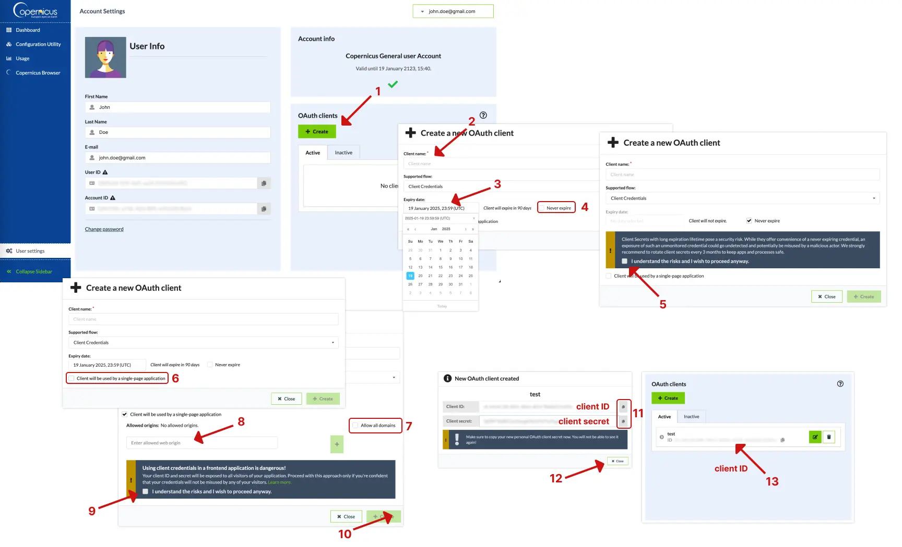
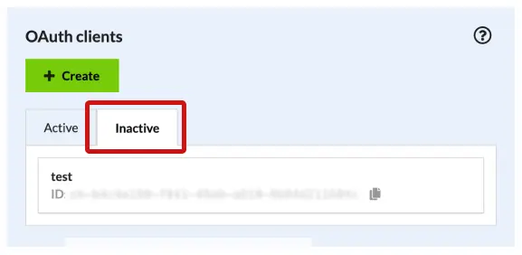

# Configuration

`sentinel-hub` talks to the Sentinel Hub APIs on the
[Copernicus Data Space Ecosystem (CDSE)](https://dataspace.copernicus.eu/).
The APIs use OAuth2, so before you can make requests you need an **OAuth client**
(a client ID and a client secret) and you need to tell the library about it.

- [1. Get your credentials](#1-get-your-credentials)
- [2. Configure the library](#2-configure-the-library)
- [3. Configuration reference](#3-configuration-reference)

## 1. Get your credentials

### Create a CDSE account

If you don't have one yet, register for a free account at
<https://dataspace.copernicus.eu/> (**Login** → **Register**).

### Register an OAuth client

1. Open the [Sentinel Hub Dashboard](https://shapps.dataspace.copernicus.eu/dashboard/#/account/settings)
   and go to **User settings**.
2. In the **OAuth clients** section click **Create** **(1)**.
3. Enter a name for the client **(2)**.
4. Choose an expiry date **(3)**, or tick **Never expire** **(4)**. If you choose
   never expire you must confirm that you understand the risks **(5)**.
   CDSE recommends rotating client secrets regularly (e.g. every 3 months).
5. Leave **Client will be used by a single-page application** **(6)** unchecked.
   This library runs on your machine / server, not in a browser, so steps
   **(7)–(9)** don't apply.
6. Click **Create** **(10)**.
7. **Copy the client ID and the client secret (11) right away.** The secret is
   shown only once and cannot be retrieved after the pop-up closes. If you lose
   it, delete the client and create a new one.
8. Click **Close** **(12)**. The new client is now listed under **OAuth clients** **(13)**.



*Screenshot: [CDSE documentation – Authentication](https://documentation.dataspace.copernicus.eu/APIs/SentinelHub/Overview/Authentication.html)*

### Expired clients

When a client expires (or is deleted) it moves to the **Inactive** tab and can no
longer be used to obtain tokens. Create a new client and update your configuration.



## 2. Configure the library

Credentials and settings are handled by `SHConfig`. Values are resolved in this
order (highest priority first):

1. Keyword arguments passed to `SHConfig(...)`
2. Environment variables `SH_CLIENT_ID` / `SH_CLIENT_SECRET`
3. The selected profile in `config.toml`
4. Built-in defaults

### Option A: save to `config.toml` (recommended)

Run this once:

```python
from sentinel_hub import SHConfig

config = SHConfig()
config.sh_client_id = "<your client ID>"
config.sh_client_secret = "<your client secret>"
config.save()
```

From then on, `SHConfig()` picks the credentials up automatically.

The file lives at the repository root (`SHConfig.get_config_location()` returns
the exact path) and is created automatically on first use. It is listed in
`.gitignore` – **never commit it**. You can also edit it by hand:

```toml
[default-profile]
sh_client_id = "<your client ID>"
sh_client_secret = "<your client secret>"
```

Keys are case-insensitive (`SH_CLIENT_ID` works too). `save()` only writes values
that differ from the defaults.

### Option B: environment variables

Useful for CI or containers, where you don't want a file on disk:

```bash
# bash / zsh
export SH_CLIENT_ID="<your client ID>"
export SH_CLIENT_SECRET="<your client secret>"
```

```powershell
# PowerShell
$env:SH_CLIENT_ID = "<your client ID>"
$env:SH_CLIENT_SECRET = "<your client secret>"
```

Environment variables override whatever is stored in `config.toml`.

### Option C: pass values directly

```python
config = SHConfig(sh_client_id="...", sh_client_secret="...")
```

Handy for quick experiments, but avoid hard-coding secrets in source files.

### Profiles

You can keep several configurations (e.g. separate accounts) side by side as
profiles. The default one is called `default-profile`.

```python
config = SHConfig()
config.sh_client_id = "<other client ID>"
config.sh_client_secret = "<other client secret>"
config.save(profile="work")

work_config = SHConfig(profile="work")
```

Instead of passing `profile=...` every time, set the `SH_PROFILE` environment
variable; it is used by `SHConfig()`, `SHConfig.load()` and `save()` whenever no
profile is given explicitly. Loading a profile that doesn't exist raises a
`KeyError`.

### Checking your configuration

Printing a config is safe – credentials are masked:

```python
>>> print(SHConfig())
{
  "sh_client_id": "**********************************a1b2",
  "sh_client_secret": "****************************wxyz",
  ...
}
```

## 3. Configuration reference

| Parameter | Default | Description |
|---|---|---|
| `sh_client_id` | `""` | OAuth client ID. Env: `SH_CLIENT_ID` |
| `sh_client_secret` | `""` | OAuth client secret. Env: `SH_CLIENT_SECRET` |
| `sh_base_url` | `https://sh.dataspace.copernicus.eu` | Sentinel Hub service URL |
| `sh_token_url` | `https://identity.dataspace.copernicus.eu/auth/realms/CDSE/protocol/openid-connect/token` | OAuth2 token endpoint |
| `max_download_attempts` | `4` | Attempts per download before giving up |
| `download_sleep_time` | `5.0` | Seconds to wait between download attempts |
| `download_timeout_seconds` | `120.0` | Timeout for a single download request |
| `number_of_download_processes` | `1` | Number of parallel download processes |
| `max_retries` | `None` | Maximum number of retries (`None` = no limit set) |
